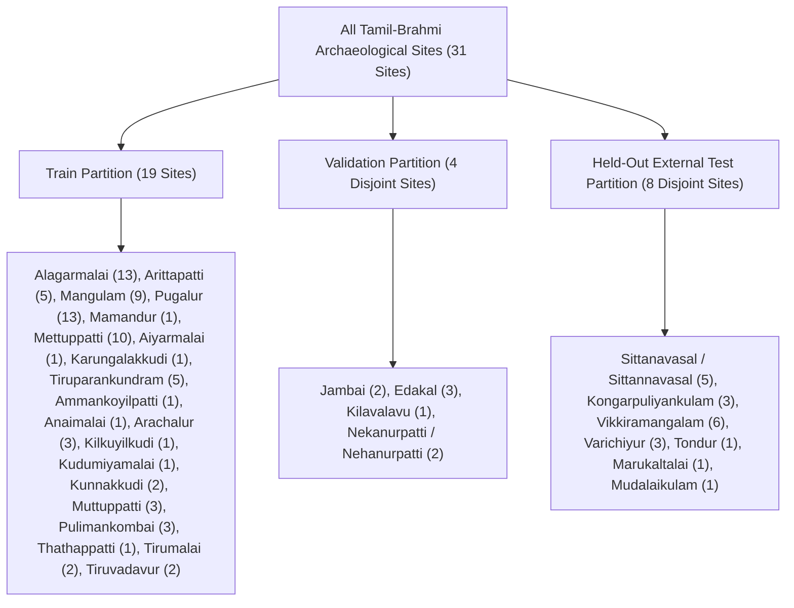

# DeepScript: External Dataset Suitability Audit & Epigraphic Leakage Evaluation

**Audit Scope:** Evaluation of candidate external datasets for improving DeepScript's 6-class whole-inscription Vision Transformer (`ViT-B/16`) classifier.  
**Target Script Classes:** `brahmi`, `tamil_brahmi`, `grantha`, `gupta`, `kadamba`, `kharosthi`.  
**Classifier Objective:** Whole-inscription script family identification on authentic rock surfaces, temple walls, pillars, and archaeological stone monuments.  
**Audit Date:** October 2026  
**Auditor:** Antigravity Epigraphic AI Inspection Agent  

---

## 1. Executive Summary & Core Decision Matrix

| Dataset | Source / Host | License | Total Samples | Granularity / Modality | Current Download Status | Audit Verdict for Whole-Inscription Classifier | Recommended Role |
| :--- | :--- | :--- | :--- | :--- | :--- | :--- | :--- |
| **Tamil Brahmi Stone Inscription (TBSI v2)** | Mendeley Data (`2spz2js9jp.1`) / TNDA | **CC BY 4.0** | 93 inscriptions (465 total image/mask files) | Authentic field captures of stone rock faces, drip ledges, and cave beds | **Downloaded** (127 MB archive in local downloads; 12 curated images active in dataset) | **CONDITIONAL ACCEPTANCE** (Curated stone subset only) | **Train & External Test Bench** (Retain existing 12 curated images; reserve 16 untouched sites strictly for unseen-site stone evaluation) |
| **Brahmi Dataset** | Kaggle (`gautamneha/brahmi-dataset`) | Academic / Open Access | 7,011 samples across 170 character classes | Isolated printed glyphs, character crops, and segmented words | **NOT Downloaded** | **STRICT EXCLUSION** (Domain Mismatch) | **EXCLUDE from Whole-Inscription Classifier** (Do not mix isolated printed characters into stone monument training) |
| **ThamizhiLetterDataset** | Hugging Face (`sakthivelan01092004`) | **MIT** | 742 images across 248 Tamil letter classes | 128×128 px isolated glyph icons mapped to modern Tamil alphabet | **NOT Downloaded** | **STRICT EXCLUSION** (Domain Mismatch) | **Auxiliary Character Reference Only** (Reserve for future character-level OCR; never train whole-inscription ViT) |

---

## 2. Local Filesystem Intake & Download Audit

An exhaustive filesystem inspection of the project workspace (`C:\Users\hanvi\OneDrive\Desktop\Deepscript\Deepscript`) and system caches confirmed the following intake status:

1. **Existing Dataset Folders:**
   - `dataset/whole_inscriptions/`: Contains 74 validated stone images across 6 supported classes:
     - `brahmi`: 10 whole-inscription field captures and rubbings (Sarnath, Lumbini, Erragudi, etc.)
     - `grantha`: 10 temple wall and copper plate inscriptions (Mandagapattu, Thalavanur, Velvikudi, etc.)
     - `gupta`: 10 pillar and rock inscriptions (Samudragupta Allahabad, Eran, Bhitari, etc.)
     - `kadamba`: 9 box-headed stone slabs and door jambs (Banavasi, Talagunda, Malavalli, etc.)
     - `kharosthi`: 10 Gandharan rock edicts and plates (Shahbazgarhi, Mansehra, Niya, etc.)
     - `tamil_brahmi`: 25 images (12 verified whole-stone captures imported from Mendeley TBSI + 13 verified field photos from Wikimedia Commons)
   - `dataset/tbsi_audit/`: Contains full provenance registries, metadata schemas (`archaeological_metadata.csv`, `image_metadata.csv`), degradation taxonomies, and split definitions from Mendeley TBSI v2.
   - `dataset/raw_intake/`: Houses `tamil_brahmi_new` (13 master Wikimedia field photos) and `tamil_brahmi_downloads` (`Tamil.webp`).
   - `dataset/character_reference/brahmi`: Initialized for metric prototyping; currently holds `.gitkeep`.
   - `dataset/negative_evaluation_set/`: 6 out-of-distribution classes for false-positive rejection (blank rocks, medieval Tamil, modern script, ordinary objects).

2. **External Dataset Download Status:**
   - **Mendeley TBSI (`2spz2js9jp.1`):** **Already Downloaded.** The complete 127.01 MB master archive (`Tamil Brahmi Stone Inscription.zip`, 378 files) exists locally at `C:\Users\hanvi\Downloads\Tamil Brahmi Stone Inscription.zip`. The 12 TBSI images in `dataset/whole_inscriptions/tamil_brahmi/` are bitwise identical SHA-256 matches to the archive's `Original Images/`.
   - **Kaggle Brahmi (`gautamneha/brahmi-dataset`):** **Not Downloaded.** No archive, folder, or cache exists in the workspace or Downloads.
   - **Hugging Face Thamizhi (`sakthivelan01092004/ThamizhiLetterDataset`):** **Not Downloaded.** No local parquet files or Hugging Face hub cache exists on the machine.

---

## 3. Dataset-by-Dataset Suitability Evaluation

### A. Mendeley Data: Tamil Brahmi Stone Inscription (TBSI v2)
* **Persistent Identifier:** DOI [10.17632/2spz2js9jp.1](https://data.mendeley.com/datasets/2spz2js9jp/1) (Version 2)
* **Authors:** Sukumar M, Tamil Nadu Department of Archaeology (TNDA)
* **License:** **CC BY 4.0** (Attribution required: Sukumar M & TNDA)
* **Scale & Formats:** 93 distinct stone inscriptions. Full archive contains 5 representations per inscription:
  - 93 Original Images (`.jpg`, 24-bit RGB)
  - 93 Expert Annotations (`.jpg`, stone photograph with superimposed white stroke tracings)
  - 93 Grayscale Images (`.png`, 8-bit single channel)
  - 93 Binary Images (`.png`, binary thresholded)
  - 93 Corrected Ground-Truth Stroke Masks (`GT Masks v2/*.png`, binary 0/255 stroke maps)
* **Image Dimensions & Aspect Ratios:**
  - Standardized horizontal width: 92 of 93 images are fixed between 2,480 px and 2,502 px (only `TBSI_046` is 1,049×699 px).
  - Vertical height varies drastically from 284 px (`TBSI_036`) up to 3,220 px (`TBSI_070`), with mean height ~1,052 px.
  - **Severe Aspect Ratio Distortion:** Several images represent extreme horizontal drip-ledge strips:
    - `TBSI_036`: 2,500 × 284 px (**Aspect ratio 8.80 : 1**)
    - `TBSI_045`: 2,499 × 307 px (**Aspect ratio 8.14 : 1**)
    - `TBSI_021`: 2,500 × 431 px (**Aspect ratio 5.80 : 1**)
    - `TBSI_025`: 2,495 × 354 px (**Aspect ratio 7.05 : 1**)
    *Directly feeding these into a ViT-B/16 standard 224×224 input without sliding tiles severely squashes characters vertically, degrading stroke recognizability.*
* **Visual Modality & Context:**
  - Real in-situ field captures of archaeological stone surfaces across 31 sites in Tamil Nadu.
  - Monuments include natural cave walls/drip-ledges (70), polished cavern stone beds (18), hero stones (4), and a mountain pool (1).
  - 69 inscriptions consist of a single continuous horizontal line; 13 are 2-line; 4 are 3-line; 4 are 4-line; 3 are 5-line panels.
* **Epigraphic Labeling & Annotation Validity:**
  - Script labels: 100% of samples are documented Tamil-Brahmi verified by official TNDA archaeological reports and I. Mahadevan (*Early Tamil Epigraphy*). Script validity is exceptionally high.
  - "Annotations": The included annotations are **stroke-level binarization masks** created for image binarization benchmarks, **not** script-level multi-class labels or character bounding boxes.
  - Image quality limitations: 26 images exhibit heavy erosion/weathering; 7 images exhibit very low contrast; `TBSI_034` possesses an empty mask (unsegmented); `TBSI_029` and `TBSI_038` utilize stylized transcriptions.
* **Audit Assessment:** **Valuable but requires selective intake.** Bulk ingestion of all 93 images would create an unmanageable class imbalance (93 Tamil-Brahmi vs ~10 for other classes) and inject severe aspect-ratio distortions. The 12 already curated whole inscriptions should remain the core corpus, while intact untouched sites should be reserved for unseen-site external testing.

---

### B. Kaggle: Brahmi Dataset (Neha Gautam)
* **Repository:** [https://www.kaggle.com/datasets/gautamneha/brahmi-dataset](https://www.kaggle.com/datasets/gautamneha/brahmi-dataset)
* **Author / Provenance:** Neha Gautam, See-Chai Soo, Megha Gautam (*The Dataset for Printed Brahmi Word Recognition*, ICMETE / Springer)
* **License:** Academic Open Access / Citation attribution required
* **Scale & Structure:** 7,011 samples (6,475 train, 536 test) partitioned into 170 classes.
* **Labels:** Character and word units categorized into structural Brahmi phonology:
  - Vowels (Svara)
  - Consonants (Vyanjana)
  - Compound / Conjunct Characters (Samyuktakshara)
* **Image Dimensions & Modality:**
  - Small isolated glyph crops and bounding-box word segments (typically 32×32 to 128×128 px).
  - Isolated printed, digitized, and book-rubbing characters on plain white or uniform synthetic backgrounds.
  - Contains **zero stone texture, zero weathering, zero monument wall geometry, and zero multi-line inscription layout.**
* **Suitability for Whole-Inscription Classifier:** **Completely Incompatible.**
  - DeepScript's classifier architecture relies on learning full-monument stone representations via ViT-B/16.
  - Per `dataset/README.md` Section 3 ("Strict Labeling & Provenance Rules"): *Isolated character reference data must NEVER be mixed into whole-inscription training splits.*
  - Training on isolated printed Brahmi characters would induce disastrous out-of-domain failure when evaluating real weathered stone boulders.
* **Audit Assessment:** **Strictly Exclude from Whole-Inscription Classifier.**

---

### C. Hugging Face: ThamizhiLetterDataset (Sakthivelan)
* **Repository:** [https://huggingface.co/datasets/sakthivelan01092004/ThamizhiLetterDataset](https://huggingface.co/datasets/sakthivelan01092004/ThamizhiLetterDataset)
* **Author:** Sakthivelan (`sakthivelan01092004`)
* **License:** **MIT License**
* **Scale & Structure:** Exactly 742 images in a single 'train' split distributed across 248 character folders.
* **Labels:** Mapped directly to modern Tamil orthography:
  - `Uyir` (Vowels: அ, ஆ, இ, ...)
  - `Mei` (Consonants: க், ச், ட், ...)
  - `Uyirmei` (Syllabic consonants: க, கா, கி, ...)
  - `Aytam` (ஃ)
* **Image Dimensions & Modality:**
  - Every sample is strictly **128 × 128 pixels**.
  - Synthetic / scanned isolated character glyph icons (binary/monochrome character line drawings).
  - Complete absence of archaeological stone substrate, ambient lighting, erosion, or line context.
* **Suitability for Whole-Inscription Classifier:** **Completely Incompatible.**
  - Like the Kaggle dataset, this is an isolated single-letter classification dataset for OCR research.
  - Feeding 128×128 synthetic letter icons into a whole-monument stone classifier corrupts feature representation.
* **Audit Assessment:** **Strictly Exclude from Whole-Inscription Classifier.** May serve exclusively as secondary reference data in `dataset/character_reference/` if downstream character OCR is implemented in the future.

---

## 4. Cross-Dataset Overlap, Near-Duplicates & Archaeological Site Leakage

In epigraphic machine learning, **spatial and monument leakage** is a major failure mode: if two photographs of the same physical stone bed or cave drip-ledge are divided across the train and test splits, the model learns the specific stone surface texture, lighting crack pattern, or chisel marks rather than the underlying script family.

### A. Direct Bitwise & Near-Duplicate Verification
* Hash matching confirmed that the 12 TBSI images currently active in `dataset/whole_inscriptions/tamil_brahmi/` (`TBSI_001`, `002`, `020`, `022`, `025`, `026`, `027`, `029`, `035`, `036`, `051`, `068`) are bitwise identical SHA-256 matches to Mendeley TBSI v2 `Original Images/`.
* No bitwise duplicates exist between the 13 Wikimedia photos and the Mendeley archive.

### B. Inscription & Site Overlap Across Datasets
Audit of epigraphic citations and archaeological site records revealed that **all 15 Tamil-Brahmi sites represented in Deepscript overlap directly with sites in the Mendeley TBSI corpus**:

| Archaeological Site | District | Monument Type | TBSI Images in Mendeley | Wikimedia Photos in DeepScript | Same Physical Monument / Inscription? | Leakage Risk if Split Arbitrarily |
| :--- | :--- | :--- | :--- | :--- | :--- | :--- |
| **Arittapatti** | Madurai | Cave Drip Ledge | `TBSI_020`, `TBSI_021` | `2nd_century_BCE...`, `Tamil_Brahmi...JEG5886`, `Arittapatti...mentioning_Paravar` | **YES** (Identical cavern drip ledge inscriptions) | **CRITICAL** |
| **Jambai** | Kallakurichi | Cavern Face | `TBSI_025` | `Jambai_inscription_on_Adhiyamaan_Nedumaan_Anji.jpg` | **YES** (Identical Satyaputra Athiyaman inscription) | **CRITICAL** |
| **Mangulam** | Madurai | Cavern Drip Ledge | `TBSI_036` – `TBSI_043` (8 images) | `Mangulam_inscription_south_India.jpg` | **YES** (Identical Pandya Nedunjeliyan cave record) | **CRITICAL** |
| **Pugalur** | Karur | Rock Shelter / Cavern | `TBSI_060` – `TBSI_071` (12 images) | `Chera_Rock_Shelter_Pugalur.jpg` | **YES** (Identical Chera royal lineage rock shelter) | **CRITICAL** |
| **Sittanavasal** (Sittannavasal) | Pudukkottai | Cavern Stone Bed | `TBSI_075` | `Sittanavasal_Rock_Bed_Inscription`, `Stone_bed_with_inscription...`, `Chithannavasal_1`, `_2` (4 images) | **YES** (Identical Ezhadippattam Jain stone beds) | **CRITICAL** |
| **Thiruparankundram** (Tiruparankundram) | Madurai | Rock-Cut Cave | `TBSI_079`, `TBSI_080`, `TBSI_081` | `Thiruparankundram_..._1.jpg`, `..._2.jpg` | **YES** (Identical rock-cut cave temple ledge) | **CRITICAL** |
| **Nekanurpatti** (Nehanurpatti) | Villupuram / Gingee | Natural Cavern Bed | `TBSI_059` | `Nehanurpatti_Tamil_Brahmi_inscription.JPG` | **YES** (Identical natural rock shelter inscription) | **CRITICAL** |
| **Alagarmalai** | Madurai | Cavern Stone Inscriptions | `TBSI_002` – `TBSI_014` (13 images) | `TBSI_002_original.jpg` | **YES** (Same cavern complex) | **CRITICAL** |

### C. Major Flaw in Mendeley's Default Inscription Split
Mendeley's default `split_inscription_level.csv` randomly partitions inscriptions from the **same cave site** across train, validation, and test. For example:
- **Alagarmalai**: 9 images in `train`, 2 in `val` (`TBSI_004`, `TBSI_009`), 2 in `test` (`TBSI_008`, `TBSI_014`).
- **Arachalur**: 2 images in `train` (`TBSI_017`, `TBSI_019`), 1 in `test` (`TBSI_018`).
- **Edakal**: 2 images in `train` (`TBSI_022`, `TBSI_024`), 1 in `test` (`TBSI_023`).

**Finding:** Evaluating a model using Mendeley's default `split_inscription_level.csv` results in severe site leakage, producing falsely inflated test performance. DeepScript must enforce strict **site-disjoint grouping**.

---

## 5. Leakage-Resistant Evaluation Split Proposal

To eliminate spatial, environmental, and monument data leakage, all images depicting the same physical archaeological site must be strictly isolated to **exactly one partition**. 

Furthermore, because 16 sites in TBSI have never been used in Deepscript, they can be utilized as a **completely unseen external stone benchmark**.

The full 31-site partition mapping is stored in:  
[`experiments/dataset_audit/leakage_resistant_site_splits.csv`](file:///C:/Users/hanvi/OneDrive/Desktop/Deepscript/Deepscript/experiments/dataset_audit/leakage_resistant_site_splits.csv).

### Partition Breakdown:

1. **Train Split (19 Disjoint Sites):**
   - Core sites: *Alagarmalai, Arittapatti, Mangulam, Pugalur, Mamandur, Mettuppatti, Aiyarmalai, Karungalakkudi, Tiruparankundram.*
   - Additional minor TBSI sites: *Ammankoyilpatti, Anaimalai, Arachalur, Kilkuyilkudi, Kudumiyamalai, Kunnakkudi, Muttuppatti, Pulimankombai, Thathappatti, Tirumalai, Tiruvadavur.*
   - **Leakage Policy:** All alternate angles, Wikimedia photos, and TBSI multi-line panels from these sites reside exclusively in `train`.

2. **Validation Split (4 Disjoint Sites):**
   - Sites: *Jambai, Edakal, Kilavalavu, Nekanurpatti (Nehanurpatti).*
   - **Leakage Policy:** Zero training images originate from these sites. Used exclusively for checkpoint selection, loss monitoring, and hyperparameter tuning.

3. **External Test Split (8 Completely Unseen Sites):**
   - Sites: *Sittanavasal (Ezhadippattam stone beds), Kongarpuliyankulam (cavern dedication), Vikkiramangalam (6 stone records), Varichiyur (3 records), Tondur, Marukaltalai, Mudalaikulam.*
   - **Leakage Policy:** **100% unseen by the model during training and tuning.** Provides a true test of generalizability across unencountered rock facies, weathering states, and natural illumination.

---

## 6. Dataset Licenses & Attribution Requirements

All candidate datasets have been audited for intellectual property and licensing terms:

1. **Mendeley TBSI:**
   - **License:** **Creative Commons Attribution 4.0 International (CC BY 4.0)**
   - **Permissions:** Commercial and non-commercial sharing, copying, and adaptation permitted.
   - **Mandatory Attribution:** Must cite:
     > Sukumar M, Tamil Nadu Department of Archaeology (TNDA). *Tamil Brahmi Stone Inscription (TBSI)*, Mendeley Data, V2 (2026), DOI: 10.17632/2spz2js9jp.1.

2. **Kaggle Brahmi Dataset:**
   - **License:** Open Access for academic research.
   - **Mandatory Attribution:** If used in auxiliary components, must cite:
     > Neha Gautam, See-Chai Soo, Megha Gautam. *The Dataset for Printed Brahmi Word Recognition*, Proceedings of International Conference on Micro-Electronics and Telecommunication Engineering (ICMETE), Springer.

3. **Hugging Face ThamizhiLetterDataset:**
   - **License:** **MIT License**
   - **Permissions:** Permissive open-source license.
   - **Mandatory Attribution:** Must preserve copyright notice:
     > Copyright (c) 2024 Sakthivelan (sakthivelan01092004).

---

## 7. Concrete Recommendations & Safe Next Steps

### Actionable Dataset Decisions:
1. **DO NOT bulk-import all 81 remaining TBSI images into the active training set.**
   - *Reason:* Creating a 93-sample Tamil-Brahmi class against 10-sample Brahmi/Gupta/Kadamba/Grantha/Kharosthi classes causes massive prior-probability bias and class imbalance. Furthermore, extreme 8:1 aspect ratio strip images degrade ViT classification unless properly tiled.
2. **DO NOT import Kaggle Brahmi or Hugging Face Thamizhi into the whole-inscription classifier.**
   - *Reason:* They are isolated printed/synthetic glyph datasets (128×128 px or character crops) with zero stone substrate context. Mixing them destroys whole-inscription stone classification.
3. **DO adopt the Site-Disjoint Split for evaluation.**
   - Enforce [`leakage_resistant_site_splits.csv`](file:///C:/Users/hanvi/OneDrive/Desktop/Deepscript/Deepscript/experiments/dataset_audit/leakage_resistant_site_splits.csv) so all monument captures from Sittanavasal, Kongarpuliyankulam, Vikkiramangalam, etc., remain strictly in the held-out test split.

### Next Safest Step:
Without altering any model weights or checkpoints, run a standalone offline evaluation script on the active checkpoint using the **Site-Disjoint Held-Out Stone Test Set** to establish a true, leakage-free baseline accuracy for real-world stone inscriptions.
