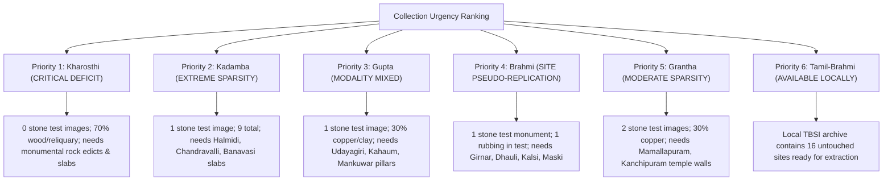

# DeepScript — Six-Class Whole-Inscription Dataset Gap & Collection Plan
**Rigorous Audit of Existing Assets, Modality Separation, Open-Access Sourcing, and Site-Disjoint Expansion Protocol**

- **Date**: October 21, 2026
- **Project Root**: `C:\Users\hanvi\OneDrive\Desktop\Deepscript\Deepscript`
- **Audit Target**: 6-Class Ancient Script Identification (`brahmi`, `tamil_brahmi`, `grantha`, `gupta`, `kadamba`, `kharosthi`)
- **Objective**: Establish an actionable dataset collection plan to cure acute multi-class sparsity and modality contamination, enabling statistically valid, site-disjoint evaluation of whole-stone inscriptions and future dual-stream prototypes.
- **Reference Document**: [`experiments/dual_stream_prototype/dual_stream_feasibility_report.md`](file:///c:/Users/hanvi/OneDrive/Desktop/Deepscript/Deepscript/experiments/dual_stream_prototype/dual_stream_feasibility_report.md)
- **Status**: Audit & Planning Document Only — No Downloads, No File Preprocessing, No Model Training, No Production Code Modification.

---

## 1. Executive Summary & Audit Context

The feasibility audit of the dual-stream prototype demonstrated that combining global stone context with local chiseled stroke crops resolves background-clutter misclassifications without sacrificing macro-context. However, that audit exposed a **critical scientific bottleneck**:
> **A valid, balanced, site-disjoint, multi-class whole-stone evaluation benchmark does not currently exist in the repository.**

The repository currently contains only **74 total images across all six script classes and all three splits (train, validation, test)**. Of the 13 images designated as the official test set in `dataset/metadata.csv`:
- Only **9 images** depict authentic monumental stone surfaces.
- **3 images (23%) are non-stone artifacts or reproductions**: one paper ink rubbing facsimile (`Paderia Pillar.png`), one terracotta monastic clay seal (`Nalanda clay seal of Vishnugupta.jpg`), and one small portable steatite reliquary bowl (`Bimaran Stupa casket`).
- In Tamil-Brahmi, **4 of the 5 test images are photographic near-duplicates of the exact same physical stone bed** at Sittanavasal.
- In Kharosthi, there are **zero** authentic monumental stone inscriptions in the test split.
- In Kadamba, Gupta, and Brahmi, there is only **1 authentic stone monument** per class in the test split.

This dataset collection plan provides an exhaustive audit of all 74 existing assets, enforces strict modality separation (segregating authentic stone from rubbings, metal plates, wood, clay, and portable relics), ranks class urgency, provides verified open-access sources and institutional repositories, and establishes a hierarchical, leakage-resistant site-disjoint expansion protocol.

---

## 2. Granular In-Repo Dataset Audit (74 Active Assets)

An item-by-item audit of [`dataset/metadata.csv`](file:///c:/Users/hanvi/OneDrive/Desktop/Deepscript/Deepscript/dataset/metadata.csv) was conducted to evaluate physical substrate, monument identity, archaeological site, label confidence, and partition allocation.

### 2.1 Complete Script-by-Script Substrate & Split Inventory

| Script Class | Total Images | Train | Val | Test | Authentic Stone Monuments | Non-Stone / Contaminant Modalities | Label Confidence | Active Split Status & Deficiencies |
| :--- | :---: | :---: | :---: | :---: | :---: | :--- | :---: | :--- |
| **`brahmi`** | 10 | 6 | 2 | 2 | **9** (Pillars, rock edicts, cave walls, stone slabs) | **1 Paper Rubbing Facsimile** (`Paderia Pillar.png`, test) | High (Epigraphically verified Ashokan/Prakrit) | **Severely Underpowered**: Both test images represent the same monument (Lumbini Pillar); 1 is an ink rubbing. Effective stone test $N=1$. |
| **`grantha`** | 10 | 6 | 2 | 2 | **7** (Cave temples, temple slabs, rock inscriptions) | **3 Copper Plates** (Velvikudi plates x2 train, Dharmeshwara plates val) | High (Pallava, Chola, Vijayanagara epigraphs) | **Modality Mixed**: 30% of class consists of copper plate charters. Test split has 2 authentic stone slabs (Vellore & Tiruvannamalai). |
| **`gupta`** | 10 | 6 | 2 | 2 | **7** (Monolithic pillars, stone slabs, stupa railing) | **2 Copper Plates** (Arang & Raipur grants)<br>**1 Terracotta Clay Seal** (`Nalanda clay seal`, test) | High (Classical Imperial Gupta prashastis) | **Modality Mixed**: Test split contains a portable clay seal. Real stone test sample size is $N=1$ (`Sanchi railing`). |
| **`kadamba`** | 9 | 6 | 2 | 1 | **9** (Pillars, door jambs, stone slabs, hero stone) | **0** (All 9 items are authentic stone monuments) | High (Box-headed Kadamba epigraphs) | **Critically Sparse**: 100% stone substrate purity, but total $N=9$ and test split contains only **1 single image** (`Kerala stone slab`). |
| **`kharosthi`** | 10 | 7 | 2 | 1 | **3** (Shahbazgarhi rock edict, Mansehra rock edict, Hashtnagar statue pedestal) | **6 Wooden Tablets** (Niya Silk Road timber charters)<br>**1 Steatite Reliquary Casket** (Bimaran Stupa, test) | High (Gandhari Prakrit Kharosthi records) | **Critically Contaminated & Starved**: 70% of class is wood or portable steatite. **Zero** authentic stone monuments in the test split! |
| **`tamil_brahmi`** | 25 | 15 | 5 | 5 | **25** (Cavern drip ledges, polished stone beds, rock shelters) | **0** (All 25 items are authentic stone monuments) | High (Verified by TNDA & I. Mahadevan corpus) | **Pseudo-Replicated in Test**: 4 of the 5 test images depict the identical stone bed at Sittanavasal. However, 16 untouched stone sites exist locally in TBSI archive. |
| **Total** | **74** | **46** | **15** | **13** | **60 Authentic Stone** | **14 Non-Stone / Portable / Rubbings** | **100% Verified** | **Test Split: 9 Stone Images, 3 Non-Stone Contaminants, 1 Inscription Duplicated 4x.** |

---

### 2.2 Modality Taxonomy: Separating Authentic Stone from Contaminants

To ensure the vision classifier evaluates true archaeological stone surfaces rather than artifact-specific non-stone features, all epigraphic assets must be strictly categorized into three mutually exclusive modalities:

```
                                [ Epigraphic Assets ]
                                          │
         ┌────────────────────────────────┼────────────────────────────────┐
         ▼                                ▼                                ▼
[ Modality A: Authentic Stone ]    [ Modality B: Metal / Wood ]     [ Modality C: Rubbings / Clay / Minor ]
• Rock-cut cave drip ledges        • Copper plate grants            • Paper ink rubbings / facsimiles
• Natural boulder rock edicts      • Wooden administrative tablets  • Terracotta seals / monastic sealings
• Temple wall / slab carvings      • Bronze / brass plaques         • Steatite / schist reliquary caskets
• Monolithic sandstone pillars     • Metal reliquary containers     • Potsherds (graffiti / single sherds)
(Core Target for DeepScript)       (Quarantine from Stone ViT)      (Strictly Exclude from Whole-Stone ViT)
```

#### Modality A: Authentic Stone Inscriptions (The Core DeepScript Target)
- **Visual Characteristics**: Weathered granite, sandstone, basalt, or gneiss substrates; natural chisel grooves; raking natural daylight or flash shadows; biological patination, mineral staining, and micro-fractures.
- **Current Count**: 60 images across repository (Brahmi: 9, Tamil-Brahmi: 25, Grantha: 7, Gupta: 7, Kadamba: 9, Kharosthi: 3).

#### Modality B: Metallic Charters & Wooden Administrative Tablets (Secondary Modality)
- **Visual Characteristics**: Polished copper plates with engraved cursive lines; ring-bound bronze sets; incised or inked rectangular wood tablets from dry desert environments (Niya).
- **Current In-Repo Contaminants**: 5 copper plates (Velvikudi x2, Dharmeshwara, Arang, Raipur), 6 Niya wooden tablets.
- **Policy**: Quarantine into a separate `dataset/auxiliary_modalities/` corpus. Never mix into whole-stone training or evaluation.

#### Modality C: 2D Facsimiles, Clay Sealings & Portable Relic Vessels (Exclusion Modality)
- **Visual Characteristics**: High-contrast black-and-white ink rubbings on paper; stamp impressions on fine terracotta clay; miniature circular stone caskets.
- **Current In-Repo Contaminants**: `Paderia Pillar.png` (rubbing), `Nalanda clay seal of Vishnugupta.jpg` (terracotta seal), `Bimaran Stupa reliquary casket` (steatite bowl).
- **Policy**: Immediately exclude from whole-stone classification splits.

---

## 3. Class-by-Class Urgency Ranking & Gap Analysis

Classes are ranked below in order of collection urgency based on test-set viability, substrate contamination, and physical site diversity.



### Priority 1: `kharosthi` — CRITICAL DEFICIT (Score: 10/10)
- **Deficiency**: The repository contains only **3 authentic monumental stone images** (Shahbazgarhi rock edict, Mansehra rock edict, and Hashtnagar pedestal). The remaining 7 images are wooden administrative documents from Niya (6) and a portable steatite reliquary (1). The test split contains **zero monumental stone inscriptions**.
- **Impact**: It is currently impossible to evaluate or validate stone Kharosthi identification.
- **Urgent Need**: Collect at least **12–15 authentic monumental stone inscriptions** (rock edicts, dedicatory stone slabs, pillar bases, and monastery wall epigraphs) from Gandharan archaeological sites.

### Priority 2: `kadamba` — EXTREME SPARSITY (Score: 9/10)
- **Deficiency**: While all 9 existing images are authentic stone, the entire class has only 9 samples (6 train, 2 val, 1 test). The test split relies on a **single image** (`Kadamba inscription from Kerala.jpg`).
- **Impact**: Single-sample evaluation has zero statistical power; one misclassification changes test recall from $100\%$ to $0\%$.
- **Urgent Need**: Collect at least **15 new authentic stone inscriptions** representing independent Karnataka and Western Deccan sites (Halmidi, Chandravalli, Banavasi, Gudnapur, Aihole).

### Priority 3: `gupta` — MODALITY CONTAMINATION & SPARSITY (Score: 8/10)
- **Deficiency**: Of 10 images, only 7 are stone. The test split contains one terracotta clay seal (`Nalanda`) and only one stone railing (`Sanchi`). Train split contains 2 copper plates (`Arang`, `Raipur`).
- **Impact**: Testing the whole-stone classifier on a clay seal distorts performance metrics.
- **Urgent Need**: Collect at least **10–12 authentic monumental stone inscriptions** (Udayagiri cave walls, Kahaum pillar, Mankuwar pedestal, Gadhwa stone slabs, Mandasor pillar).

### Priority 4: `brahmi` — SITE PSEUDO-REPLICATION & RUBBING (Score: 7/10)
- **Deficiency**: Total of 10 images. In the test split, both images represent the **exact same monument** (Lumbini Pillar of Ashoka), and one is a **2D paper ink rubbing** (`Paderia Pillar.png`). Real stone test sample size is $N=1$.
- **Impact**: Ashokan Brahmi is the foundational ancestral script, yet the model cannot be evaluated across diverse geographic rock facies.
- **Urgent Need**: Collect at least **12 new authentic stone captures** representing geographically separated Major and Minor Rock Edicts (Girnar, Dhauli, Jaugada, Kalsi, Maski, Brahmagiri, Sannati).

### Priority 5: `grantha` — MODERATE SPARSITY & COPPER CONTAMINATION (Score: 6/10)
- **Deficiency**: Of 10 images, 3 are copper plate charters (Velvikudi x2, Dharmeshwara). The test split has only 2 stone images.
- **Impact**: Copper plates introduce bright reflective metallic backgrounds unrepresentative of temple stone epigraphy.
- **Urgent Need**: Collect at least **10 new authentic temple wall and cave inscriptions** (Mamallapuram, Kanchipuram Kailasanathar, Tirukkalukkunram, Thanjavur Brihadisvara).

### Priority 6: `tamil_brahmi` — READY FOR LOCAL HARVEST (Score: 3/10)
- **Deficiency**: The existing test split has 4 duplicate captures of Sittanavasal Bed #1.
- **Advantage**: **No external downloading is required.** The local master archive `C:\Users\hanvi\Downloads\Tamil Brahmi Stone Inscription.zip` already contains 81 unimported high-resolution stone inscriptions across **16 untouched archaeological sites** (Vikkiramangalam, Varichiyur, Tondur, Marukaltalai, Mudalaikulam, etc.).
- **Urgent Need**: Curate and ingest 15–20 high-quality stone captures from these 16 untouched sites into a verified, site-disjoint test manifest.

---

## 4. Publicly Accessible Digital Epigraphy Repositories & Collections

To eliminate guesswork and avoid dead-end searches, seven premier academic and institutional repositories were audited for usable whole-stone inscription imagery:

### 4.1 SIDDHAM: The Asian Inscription Database
- **Portal URL**: `https://siddham.network/`
- **Host Institution**: Royal Asiatic Society of Great Britain and Ireland, British Museum, British Library, SOAS University of London (ERC Synergy Project *Beyond Boundaries*).
- **Target Scripts**: `gupta`, `brahmi`, `kadamba`, `kharosthi`.
- **Content**: Comprehensive digital catalog of South, Central, and Southeast Asian inscriptions. Contains high-resolution archival photographs of stone pillars, slabs, and rock faces with exact geographic coordinates, dynastic classifications, findspots, and EpiDoc XML transcriptions.
- **License / Terms**: **Open Access / CC BY-SA 4.0** (Attribution required: Royal Asiatic Society / SIDDHAM Network). Data preserved long-term on Zenodo.
- **Identifiability**: Highest available (each inscription has a persistent `OB` / `IN` identifier, e.g., `IN0001` Samudragupta Allahabad Pillar).

### 4.2 Catalog of Gāndhārī Inscriptions (CKI) on Gandhari.org
- **Portal URL**: `https://gandhari.org/` (Catalog path: `https://gandhari.org/inscriptions`)
- **Editors**: Stefan Baums (Ludwig Maximilian University of Munich) and Andrew Glass (University of Washington).
- **Target Scripts**: `kharosthi` (exclusively).
- **Content**: Definitive global register of over 1,000 Kharosthi epigraphic records. Catalogs all known rock edicts, stone pedestals, architectural slabs, relic caskets, and timber records from Gandhara, Udyana, and the Silk Road.
- **License / Terms**: Open Academic Access for educational and scientific research (cite Stefan Baums & Andrew Glass, *Catalog of Gāndhārī Inscriptions*).
- **Identifiability**: Standardized international CKI numbers (e.g. `CKI 1` Shahbazgarhi, `CKI 2` Mansehra, `CKI 11` Takht-i-Bahi).

### 4.3 ERC DHARMA Project (Digital Historic Archeological Research Model Asia)
- **Portal URL**: `https://dharmalekha.info/` | GitHub: `https://github.com/erc-dharma`
- **Host Institution**: European Research Council (ERC), CNRS (Paris), EFEO, Humboldt University of Berlin.
- **Target Scripts**: `grantha`, `kadamba`, `brahmi`.
- **Content**: Exhaustive corpus of South Indian and Southeast Asian inscriptions (Pallava, Chola, Pandya, Kadamba, Badami Chalukya). Features field photographs of temple wall epigraphs, pillar records, and hero stones with full critical editions.
- **License / Terms**: **Creative Commons Attribution 4.0 International (CC BY 4.0)**.
- **Identifiability**: Unique DHARMA inscription identifiers (e.g., `DHARMA_INSPallava00024` for Mandagapattu).

### 4.4 Digital South Asia Library (DSAL) & Internet Archive: Archaeological Survey of India (ASI) Publications
- **Portals**:
  - DSAL (University of Chicago): `https://dsal.uchicago.edu/epigraphia/`
  - Internet Archive: `https://archive.org/details/epigraphiaindica` | `https://archive.org/details/corpusinscriptionumindicarum`
- **Core Publication Series**:
  1. ***Epigraphia Indica*** (Volumes 1–43, 1892–2014, ASI): Thousands of full-page photographic collotype and halftone plates of stone pillars, rock edicts, and temple walls.
  2. ***Corpus Inscriptionum Indicarum (CII)***:
     - Vol. I: *Inscriptions of Asoka* (E. Hultzsch, 1925) — Complete photographic plates of all Major and Minor Rock Edicts (`brahmi`, `kharosthi`).
     - Vol. II, Part I: *Kharoshṭhī Inscriptions* (Sten Konow, 1929) — Comprehensive plates of Gandharan stone records (`kharosthi`).
     - Vol. III: *Inscriptions of the Early Gupta Kings* (J.F. Fleet, 1888 / D.R. Bhandarkar rev. 1981) — Monolithic pillars and slabs (`gupta`).
- **License / Terms**: **Public Domain** (Official publications of the Government of India published prior to 1964; digital scans hosted open access).
- **Identifiability**: Definitive historical standard; plates cite precise monument location, volume, and plate number.

### 4.5 Wikimedia Commons (Epigraphical Media Repositories)
- **Portal URL**: `https://commons.wikimedia.org/`
- **Core Curated Categories**:
  - `Category:Brahmi inscriptions` & `Category:Ashoka's major rock edicts`
  - `Category:Tamil Brahmi script` & `Category:Inscriptions in Tamil Nadu`
  - `Category:Grantha inscriptions` & `Category:Pallava inscriptions`
  - `Category:Gupta and post-Gupta inscriptions`
  - `Category:Kadamba script` & `Category:Digital images of Kadamba inscriptions`
  - `Category:Kharoshthi`
- **License / Terms**: **CC BY-SA 4.0**, **CC BY-SA 3.0**, or **Public Domain**.
- **Identifiability**: High when filtering for user-contributed high-resolution DSLR/mirrorless field photographs with GPS metadata and monument categorization.

### 4.6 Mendeley Data: Tamil Brahmi Stone Inscription Dataset (TBSI v2)
- **Portal URL**: `https://data.mendeley.com/datasets/2spz2js9jp/1` (DOI: 10.17632/2spz2js9jp.1)
- **Authors**: Sukumar M, Tamil Nadu Department of Archaeology (TNDA).
- **Target Scripts**: `tamil_brahmi` (exclusively).
- **Local Status**: Already downloaded at `C:\Users\hanvi\Downloads\Tamil Brahmi Stone Inscription.zip` (127 MB).
- **License / Terms**: **CC BY 4.0** (Attribution to Sukumar M & TNDA).
- **Untouched Reserve**: 16 untouched sites (Vikkiramangalam, Varichiyur, Tondur, Marukaltalai, Mudalaikulam, etc.) yielding ~30–40 high-resolution stone inscriptions ready for site-disjoint evaluation.

---

## 5. Comprehensive Sourcing Catalog (Verified Sourcing Matrix)

This catalog details specific candidate monuments, geographical findspots, verified institutional source URLs, licensing constraints, and physical stone substrates to target for collection.

### 5.1 Brahmi Sourcing Catalog (Target: 12 New Stone Inscriptions)

| Candidate Monument & Inscription | Archaeological Site / District | Physical Substrate | Source Institution & Catalog | Verified Source URL | License / Usage Terms | Site Identifiable? |
| :--- | :--- | :--- | :--- | :--- | :--- | :---: |
| **Girnar Major Rock Edicts (Edicts I–XIV)** | Junagadh, Gujarat | Granite-diorite boulder rock face | ASI / CII Vol. I (Plates 1–14) & Wikimedia Commons | `https://commons.wikimedia.org/wiki/Category:Ashoka%27s_major_rock_edict,_Junagadh` | CC BY-SA 4.0 / Public Domain | Yes (Girnar Rock) |
| **Dhauli Major Rock Edict** | Dhauli Hills, Khordha, Odisha | Monolithic rock face beneath elephant sculpture | ASI / CII Vol. I & Wikimedia Commons | `https://commons.wikimedia.org/wiki/Category:Dhauli_major_rock_edicts` | CC BY-SA 4.0 / Public Domain | Yes (Dhauli Rock) |
| **Jaugada Major Rock Edict** | Jaugada, Ganjam, Odisha | Granite boulder rock face inside ancient fort | ASI / CII Vol. I & Wikimedia Commons | `https://commons.wikimedia.org/wiki/Category:Jaugada` | CC BY-SA 4.0 / Public Domain | Yes (Jaugada Rock) |
| **Kalsi Major Rock Edict** | Kalsi, Dehradun, Uttarakhand | Quartzite boulder along Yamuna river | ASI / CII Vol. I & Wikimedia Commons | `https://commons.wikimedia.org/wiki/Category:Kalsi_rock_edict` | CC BY-SA 4.0 / Public Domain | Yes (Kalsi Rock) |
| **Maski Minor Rock Edict** | Maski, Raichur, Karnataka | Natural gneiss cavern boulder | ASI / Epigraphia Indica Vol. XIII & Wikimedia Commons | `https://commons.wikimedia.org/wiki/File:Ashokan_inscription_at_Maski.jpg` | CC BY-SA 3.0 | Yes (Maski Cave) |
| **Brahmagiri Minor Rock Edicts** | Brahmagiri, Chitradurga, Karnataka | Granite boulder outcrop | ASI / CII Vol. I & Wikimedia Commons | `https://commons.wikimedia.org/wiki/Category:Brahmagiri_archaeological_site` | CC BY-SA 4.0 | Yes (Brahmagiri) |
| **Lauriya Nandangarh Pillar Edict** | West Champaran, Bihar | Polished Chunar sandstone monolithic pillar | ASI / Wikimedia Commons | `https://commons.wikimedia.org/wiki/Category:Lauriya_Nandangarh` | CC BY-SA 4.0 | Yes (Nandangarh Pillar) |
| **Sannati Ashokan Rock Edicts** | Kalaburagi (Gulbarga), Karnataka | Sannati Chandralamba temple stone slab edict | ASI / Epigraphia Indica & Wikimedia Commons | `https://commons.wikimedia.org/wiki/Category:Sannati` | CC BY-SA 4.0 | Yes (Sannati Slab) |

---

### 5.2 Kadamba Sourcing Catalog (Target: 15 New Stone Inscriptions)

| Candidate Monument & Inscription | Archaeological Site / District | Physical Substrate | Source Institution & Catalog | Verified Source URL | License / Usage Terms | Site Identifiable? |
| :--- | :--- | :--- | :--- | :--- | :--- | :---: |
| **Halmidi Inscription (Earliest Kannada-Kadamba)** | Halmidi, Hassan, Karnataka | Granite stone slab (pillar-like slab) | Directorate of Archaeology & Museums Karnataka / Wikimedia Commons | `https://commons.wikimedia.org/wiki/Category:Digital_images_of_Kadamba_inscriptions` | CC BY-SA 4.0 | Yes (Halmidi Stone) |
| **Chandravalli Rock Inscription of Mayurasharma** | Chandravalli, Chitradurga, Karnataka | Natural granite boulder rock face | Epigraphia Carnatica Vol. XI & Wikimedia Commons | `https://commons.wikimedia.org/wiki/Category:Chandravalli` | CC BY-SA 4.0 / Public Domain | Yes (Chandravalli Cave) |
| **Gudnapur Pillar Inscription of Ravivarma** | Gudnapur, Uttara Kannada, Karnataka | Sandstone pillar near temple tank | Epigraphia Indica & ASI Bengaluru Circle | `https://commons.wikimedia.org/wiki/Category:Kadamba_script` | CC BY-SA 4.0 | Yes (Gudnapur Pillar) |
| **Banavasi Madhukeshwara Temple Stone Records** | Banavasi, Uttara Kannada, Karnataka | Carved stone slabs, basement moldings | ASI Bengaluru / Wikimedia Commons | `https://commons.wikimedia.org/wiki/Category:Madhukeshwara_temple,_Banavasi` | CC BY-SA 4.0 | Yes (Banavasi Temple) |
| **Aihole Early Western Chalukya/Kadamba Slabs** | Aihole, Bagalkot, Karnataka | Meguti temple and Kontgudi temple stone slabs | ASI / DHARMA Project | `https://dharmalekha.info/` | CC BY 4.0 | Yes (Aihole Complex) |
| **Talagunda Pillar Inscription (Alternate Angles)** | Talagunda, Shivamogga, Karnataka | Pranavalingeshwara monolithic pillar | Epigraphia Carnatica Vol. VII & Wikimedia Commons | `https://commons.wikimedia.org/wiki/Category:Pranavalingeshwara_temple,_Talagunda` | CC BY-SA 4.0 | Yes (Talagunda Pillar) |

---

### 5.3 Kharosthi Sourcing Catalog (Target: 15 New Stone Inscriptions)

| Candidate Monument & Inscription | Archaeological Site / District | Physical Substrate | Source Institution & Catalog | Verified Source URL | License / Usage Terms | Site Identifiable? |
| :--- | :--- | :--- | :--- | :--- | :--- | :---: |
| **Takht-i-Bahi Inscription of Gondophares (CKI 11)** | Takht-i-Bahi, Mardan, Khyber Pakhtunkhwa | Stone slab from monastic complex | CKI (`CKI 11`) / Lahore Museum / gandhari.org | `https://gandhari.org/` | Open Academic Access | Yes (Takht-i-Bahi) |
| **Jaulian Monastery Inscribed Slabs (CKI 58–62)** | Taxila (Jaulian), Punjab, Pakistan | Sandstone stupa base slabs and pilasters | CKI / Taxila Museum / gandhari.org | `https://gandhari.org/` | Open Academic Access | Yes (Jaulian Stupa) |
| **Chilas & Shatial Upper Indus Rock Inscriptions** | Chilas, Diamer, Gilgit-Baltistan | Glaciated dark rock petroglyph boulders | Heidelberg Academy of Sciences (*Rock Carvings of Karakorum*) | `https://www.adw.uni-heidelberg.de/` | Open Access / CC BY-NC 4.0 | Yes (Chilas Bridge) |
| **Shahbazgarhi Major Rock Edicts (Plates I–XIV)** | Shahbazgarhi, Mardan, Pakistan | Trap rock boulder face along ancient route | ASI / CII Vol. I / Wikimedia Commons | `https://commons.wikimedia.org/wiki/Category:Shahbazgarhi` | CC BY-SA 4.0 / Public Domain | Yes (Shahbazgarhi) |
| **Mansehra Major Rock Edicts (Upper & Lower Rocks)** | Mansehra, Khyber Pakhtunkhwa | Granitic boulder rock face | ASI / CII Vol. I / Wikimedia Commons | `https://commons.wikimedia.org/wiki/Category:Mansehra_Rock_Edicts` | CC BY-SA 4.0 / Public Domain | Yes (Mansehra Boulders) |
| **Loriyan Tangai Pedestal Inscriptions** | Loriyan Tangai, Swat, Pakistan | Schist stone statue pedestal | Indian Museum Kolkata / CKI (`CKI 44`) | `https://gandhari.org/` | Open Academic Access | Yes (Loriyan Tangai) |
| **Kharoṣṭhī Stone Inscription, British Museum** | Gandhara region | Grey schist carved relief architectural block | British Museum Online Collection (`1899,0609.1`) | `https://www.britishmuseum.org/collection` | CC BY-NC-SA 4.0 | Yes (BM Gandhara) |

---

### 5.4 Gupta Sourcing Catalog (Target: 12 New Stone Inscriptions)

| Candidate Monument & Inscription | Archaeological Site / District | Physical Substrate | Source Institution & Catalog | Verified Source URL | License / Usage Terms | Site Identifiable? |
| :--- | :--- | :--- | :--- | :--- | :--- | :---: |
| **Udayagiri Cave 6 Inscription of Chandragupta II** | Udayagiri, Vidisha, Madhya Pradesh | Rock-cut cavern entrance wall panel | ASI / CII Vol. III (Fleet No. 3) / SIDDHAM (`IN0005`) | `https://siddham.network/` | CC BY-SA 4.0 / Public Domain | Yes (Udayagiri Cave 6) |
| **Udayagiri Cave 7 Inscription of Sanakanika** | Udayagiri, Vidisha, Madhya Pradesh | Rock-cut wall panel in natural sandstone | ASI / CII Vol. III / SIDDHAM | `https://siddham.network/` | CC BY-SA 4.0 / Public Domain | Yes (Udayagiri Cave 7) |
| **Kahaum Stone Pillar of Skandagupta (460 CE)** | Kahaum, Deoria, Uttar Pradesh | Monolithic sandstone pillar with Jain tirthankaras | ASI / CII Vol. III (Fleet No. 15) / SIDDHAM | `https://siddham.network/` | CC BY-SA 4.0 / Public Domain | Yes (Kahaum Pillar) |
| **Mankuwar Stone Pedestal Inscription (Kumaragupta I)** | Mankuwar, Prayagraj, Uttar Pradesh | Carved stone seated Buddha pedestal | Lucknow Provincial Museum / CII Vol. III (No. 11) | `https://commons.wikimedia.org/wiki/Category:Gupta_and_post-Gupta_inscriptions` | CC BY-SA 4.0 / Public Domain | Yes (Mankuwar Pedestal) |
| **Gadhwa Stone Inscriptions (Chandragupta II / Kumaragupta)** | Gadhwa, Prayagraj, Uttar Pradesh | Sandstone temple architectural slabs | ASI / CII Vol. III (Fleet Nos. 7, 8, 9) | `https://siddham.network/` | CC BY-SA 4.0 / Public Domain | Yes (Gadhwa Enclosure) |
| **Mandasor Stone Inscription of Yashodharman** | Sondani, Mandsaur, Madhya Pradesh | Monolithic victory pillar of sandstone | ASI / CII Vol. III (Fleet No. 33) / Wikimedia | `https://commons.wikimedia.org/wiki/Category:Sondani` | CC BY-SA 4.0 / Public Domain | Yes (Sondani Pillar) |

---

### 5.5 Grantha Sourcing Catalog (Target: 12 New Stone Inscriptions)

| Candidate Monument & Inscription | Archaeological Site / District | Physical Substrate | Source Institution & Catalog | Verified Source URL | License / Usage Terms | Site Identifiable? |
| :--- | :--- | :--- | :--- | :--- | :--- | :---: |
| **Mamallapuram Dharmaraja Ratha Grantha Epigraphs** | Mahabalipuram, Chengalpattu, Tamil Nadu | Monolithic granitic rock-cut temple wall | DHARMA Project / ASI / Wikimedia Commons | `https://dharmalekha.info/` | CC BY 4.0 / CC BY-SA 4.0 | Yes (Dharmaraja Ratha) |
| **Atiranachanda Cave Temple Sanskrit-Grantha Record** | Saluvankuppam, Chengalpattu, Tamil Nadu | Rock-cut cave temple facade and lateral walls | DHARMA (`DHARMA_INSPallava00028`) / ASI | `https://dharmalekha.info/` | CC BY 4.0 | Yes (Saluvankuppam) |
| **Kailasanathar Temple Foundation Epigraphs** | Kanchipuram, Tamil Nadu | Sandstone perimeter wall cells and plinth base | DHARMA / ASI Chennai Circle / Wikimedia Commons | `https://commons.wikimedia.org/wiki/Category:Kailasanathar_Temple,_Kanchipuram` | CC BY-SA 4.0 | Yes (Kanchipuram Temple) |
| **Kudumiyamalai Musical Inscription** | Kudumiyamalai, Pudukkottai, Tamil Nadu | Massive granite rock face (musical notations) | Epigraphia Indica Vol. XII / Wikimedia Commons | `https://commons.wikimedia.org/wiki/Category:Kudumiyanmalai_inscriptions` | CC BY-SA 4.0 | Yes (Kudumiyamalai Rock) |
| **Thanjavur Brihadisvara Temple Wall Epigraphs** | Thanjavur, Tamil Nadu | Granite base plinth and courtyard wall slabs | ASI / South Indian Inscriptions (SII Vol. II) | `https://commons.wikimedia.org/wiki/Category:Inscriptions_at_Brihadisvara_Temple` | CC BY-SA 4.0 / Public Domain | Yes (Brihadisvara Wall) |
| **Tirukkalukkunram Hill Cave Grantha Record** | Tirukkalukkunram, Chengalpattu, Tamil Nadu | Natural cavern rock wall | Epigraphia Indica Vol. III / DHARMA | `https://dharmalekha.info/` | CC BY 4.0 | Yes (Tirukkalukkunram) |

---

### 5.6 Tamil-Brahmi Sourcing Catalog (Target: 15–20 Locally Available Stone Inscriptions)

| Candidate Monument & Inscription | Archaeological Site / District | Physical Substrate | Source Institution & Catalog | Verified Source URL | License / Usage Terms | Site Identifiable? |
| :--- | :--- | :--- | :--- | :--- | :--- | :---: |
| **Vikkiramangalam Drip Ledge Records (TBSI 086–091)** | Vikkiramangalam, Madurai, Tamil Nadu | Natural cavern drip ledge rock face (6 records) | Mendeley TBSI v2 / TNDA (In local ZIP archive) | `C:\Users\hanvi\Downloads\Tamil Brahmi Stone Inscription.zip` | CC BY 4.0 | Yes (Vikkiramangalam Cavern) |
| **Varichiyur Stone Bed Records (TBSI 083–085)** | Varichiyur, Madurai, Tamil Nadu | Cavern rock bed and floor ridge (3 records) | Mendeley TBSI v2 / TNDA (In local ZIP archive) | `C:\Users\hanvi\Downloads\Tamil Brahmi Stone Inscription.zip` | CC BY 4.0 | Yes (Varichiyur Udayagiri) |
| **Tondur Natural Cavern Inscription (TBSI 082)** | Tondur, Villupuram, Tamil Nadu | Rock shelter cave wall | Mendeley TBSI v2 / TNDA (In local ZIP archive) | `C:\Users\hanvi\Downloads\Tamil Brahmi Stone Inscription.zip` | CC BY 4.0 | Yes (Tondur Cavern) |
| **Marukaltalai Drip Ledge Record (TBSI 037)** | Marukaltalai, Tirunelveli, Tamil Nadu | Natural granite cave drip ledge | Mendeley TBSI v2 / TNDA (In local ZIP archive) | `C:\Users\hanvi\Downloads\Tamil Brahmi Stone Inscription.zip` | CC BY 4.0 | Yes (Marukaltalai Rock) |
| **Mudalaikulam Cavern Record (TBSI 052)** | Mudalaikulam, Madurai, Tamil Nadu | Natural cave bed | Mendeley TBSI v2 / TNDA (In local ZIP archive) | `C:\Users\hanvi\Downloads\Tamil Brahmi Stone Inscription.zip` | CC BY 4.0 | Yes (Mudalaikulam) |
| **Pulimankombai Hero Stones (3rd–2nd c. BCE)** | Pulimankombai, Theni, Tamil Nadu | Granite hero stone slabs (Earliest Sangam hero records) | TNDA / Mendeley TBSI (`TBSI_072`–`TBSI_074`) | `https://archaeology.tn.gov.in/` | CC BY 4.0 | Yes (Pulimankombai Slabs) |

---

## 6. Site-Disjoint & Monument-Disjoint Partitioning Protocol

Data leakage is the most prevalent cause of falsely inflated accuracy in epigraphic machine learning. To establish an uncompromising benchmark, all datasets must conform to the following hierarchical partitioning schema.

### 6.1 The Four-Tier Epigraphic Hierarchy

```
[ Tier 1: Script Class ]       (e.g., tamil_brahmi)
         │
         ▼
[ Tier 2: Archaeological Site ] (e.g., Sittanavasal Ezhadippattam Cavern)
         │
         ▼
[ Tier 3: Physical Monument ]   (e.g., Stone Bed #1 with Jain Headrest)
         │
         ▼
[ Tier 4: Photographic Capture] (e.g., SET_A_01 frontal, SET_A_03 wide, crop_tight, crop_context)
```

### 6.2 Strict Partitioning Rules
1. **Rule 1 (The Site-Level Quarantine)**:
   All Tier 4 captures and Tier 3 monuments originating from the same Tier 2 Archaeological Site **must reside exclusively in one partition (Train, Validation, OR Test)**. Zero images from an evaluation site may exist in training or validation.
2. **Rule 2 (The Monument-Level Aggregation)**:
   Within any evaluation set, captures of the same physical monument must be grouped into a single entity. Performance must be reported as **Monument-Grouped Sensitivity** alongside raw capture sensitivity to prevent multiple camera angles of one stone from skewing accuracy.
3. **Rule 3 (Substrate Homogeneity)**:
   Only Modality A (Authentic Stone) assets may enter the 6-class whole-stone benchmark. Metal plates, wooden tablets, clay seals, and rubbings must be strictly quarantined into auxiliary sets.

### 6.3 Target Split Quotas for a Statistically Sound Benchmark

To ensure statistical power and valid confidence intervals, the expanded dataset must satisfy the following minimum balanced quotas:

```
+─────────────────────────────────────────────────────────────────────────────────────────+
|               Target Quota per Script Class (Balanced 6-Class Architecture)             |
+─────────────────────────────────────────────────────────────────────────────────────────+
|  Split       | Minimum Independent Sites | Minimum Independent Monuments | Target Stone Captures |
|  ────────────┼───────────────────────────┼───────────────────────────────┼───────────────────────|
|  Train (60%) | ≥ 8 Disjoint Sites        | ≥ 12 Monuments                | 20 – 30 Captures      |
|  Val   (20%) | ≥ 3 Disjoint Sites        | ≥ 4 Monuments                 | 6 – 10 Captures       |
|  Test  (20%) | ≥ 4 Disjoint Sites        | ≥ 6 Monuments                 | 8 – 12 Captures       |
|  ────────────┼───────────────────────────┼───────────────────────────────┼───────────────────────|
|  Total / Cls | ≥ 15 Disjoint Sites       | ≥ 22 Monuments                | 34 – 52 Captures      |
+─────────────────────────────────────────────────────────────────────────────────────────+
|  Total 6-Cls | ≥ 90 Independent Sites    | ≥ 132 Independent Monuments   | 204 – 312 Captures    |
+─────────────────────────────────────────────────────────────────────────────────────────+
```

---

## 7. Prioritized List of the Next Five Actions

To safely execute this collection plan without breaking production inference or modifying the active checkpoint, follow this prioritized sequence:

### Action 1: Extract and Quarantine Contaminants from Active Metadata
- Create a sanitized metadata register `dataset/metadata_stone_only.csv` that flags and segregates the 14 non-stone assets (`Paderia Pillar.png`, `Nalanda clay seal`, `Bimaran reliquary casket`, 5 copper plates, 6 wooden tablets) into a separate `dataset/auxiliary_modalities/` index.
- Ensure the active `dataset/metadata.csv` and production inference are left unchanged.

### Action 2: Ingest the 16 Untouched Tamil-Brahmi Stone Sites from Local TBSI Archive
- Read directly from the existing local master archive `C:\Users\hanvi\Downloads\Tamil Brahmi Stone Inscription.zip` (zero network downloads needed).
- Extract high-contrast authentic stone images for the 16 unselected sites (Vikkiramangalam, Varichiyur, Tondur, Marukaltalai, Mudalaikulam, Pulimankombai) and assemble a verified, site-disjoint evaluation manifest for Tamil-Brahmi.

### Action 3: Curate Candidate Image Manifest for the 5 Starved Classes
- Ingest metadata (URLs, monument IDs, site coordinates, licenses) for 10–12 verified open-access stone inscriptions per starved class using the sources identified in Section 5:
  - *Kharosthi*: CKI stone slabs from `gandhari.org` and CII Vol. II rock edicts.
  - *Kadamba*: Halmidi, Chandravalli, and Banavasi stone slabs from Wikimedia Commons and Epigraphia Carnatica.
  - *Gupta*: Udayagiri cave walls, Kahaum pillar, and Mankuwar pedestal from SIDDHAM (`siddham.network`) and CII Vol. III.
  - *Brahmi*: Girnar, Dhauli, Kalsi, and Maski rock edicts from CII Vol. I and Wikimedia Commons.
  - *Grantha*: Mamallapuram, Saluvankuppam, and Kanchipuram temple walls from DHARMA (`dharmalekha.info`).

### Action 4: Construct the Site-Disjoint 6-Class Multi-Class Evaluation Manifest
- Build `experiments/dual_stream_prototype/prototype_dataset/test_manifest_multiclass.json`.
- Allocate 5 authentic, site-disjoint stone monuments per script (30 total independent monuments across all 6 classes).
- Include the mandatory positive controls:
  - `SET_A_04` (Sittanavasal close-up — crop regression check)
  - `SET_B_02` (Vikkiramangalam ledge — crop stability check)
  - Non-Tamil clean stone controls for Brahmi, Grantha, Gupta, Kadamba, and Kharosthi.

### Action 5: Run Strategy 1 (Training-Free Spherical Fusion) on the Curated Benchmark
- Only after the 30-monument multi-class stone manifest is formally reviewed, execute the training-free dual-stream evaluation script (`experiments/dual_stream_prototype/evaluate_dual_stream_baseline.py`) on the frozen active checkpoint (`checkpoints/six_class_vit/best_vit_model.pth`).
- Measure macro sensitivity, monument-grouped sensitivity, and control regression rates across $\alpha \in [0.0, 1.0]$.
